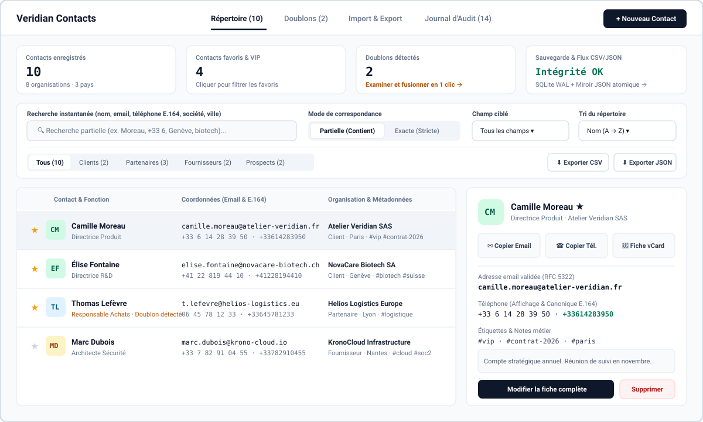
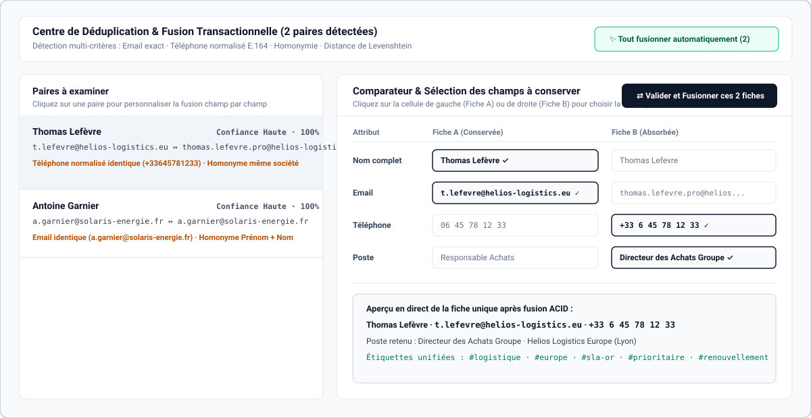
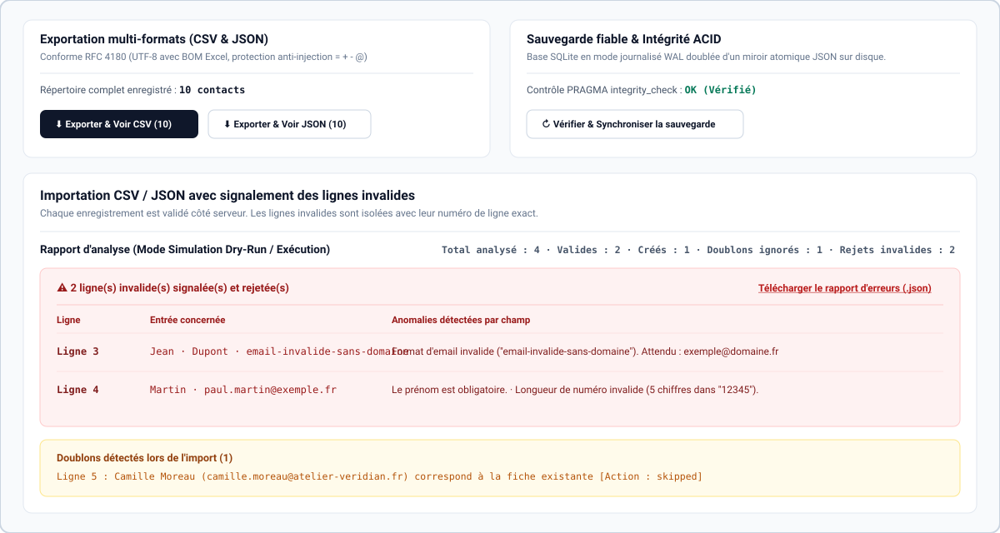
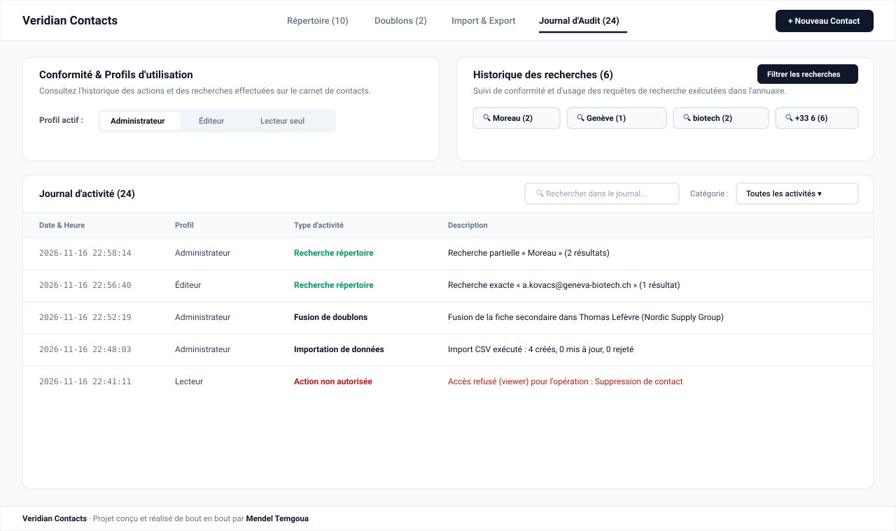
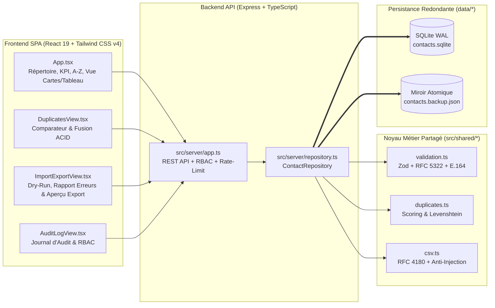

# Veridian Contacts — Gestionnaire de Contacts Professionnel


-10B981?style=flat-square)


**Veridian Contacts** est une application web full-stack de gestion de contacts B2B conçue avec une architecture modulaire, une validation stricte côté serveur et client (RFC 5322 & normalisation internationale E.164), une recherche exacte et partielle, un moteur de détection et de fusion transactionnelle des doublons, un module d'import/export CSV, JSON et vCard (`.vcf`) avec signalement des erreurs ligne par ligne, et une double persistance SQLite WAL + Miroir JSON atomique.

---

## Sommaire

1. [Aperçu Visuel & Captures d'Écran](#1-aperçu-visuel--captures-décran)
2. [Fonctionnalités & Critères d'Acceptation](#2-fonctionnalités--critères-dacceptation)
3. [Architecture & Structure du Projet](#3-architecture--structure-du-projet)
4. [Démarrage Rapide](#4-démarrage-rapide)
5. [Tests Automatisés & Qualité](#5-tests-automatisés--qualité)
6. [Documentation Complète](#6-documentation-complète)

---

## 1. Aperçu Visuel & Captures d'Écran

### A. Répertoire Principal, Recherche Exacte/Partielle, Index A–Z & Panneau Détail Contact

*Vue principale avec indicateurs clés interactifs, recherche partielle/exacte, filtrage par catégorie/étiquette, index alphabétique A–Z, copie en 1 clic et export vCard (`.vcf`).*

### B. Centre de Déduplication & Assistant de Fusion Transactionnelle ACID

*Détection multicritère (email identique, téléphone E.164 normalisé, homonymes, inversion Prénom/Nom et distance de Levenshtein) avec comparateur côte à côte et aperçu en direct de la fiche fusionnée.*

### C. Importation CSV / JSON & Rapport d'Anomalies Ligne par Ligne

*Mode simulation (Dry-Run) ou import direct isolant chaque ligne invalide avec son numéro de ligne exact et le détail des erreurs par champ sans bloquer les entrées valides.*

### D. Contrôle d'Accès (RBAC) & Journal d'Audit Immuable

*Simulation en temps réel des rôles (`admin`, `editor`, `viewer`) et traçabilité complète des opérations sensibles et des refus d'autorisation (`PERMISSION_DENIED`).*

---

## 2. Fonctionnalités & Critères d'Acceptation

| Domaine Fonctionnel | Détails de l'Implémentation | Statut |
| :--- | :--- | :---: |
| **CRUD & Ergonomie** | Création, édition, suppression avec modale de confirmation, favoris, étiquettes rapides, **Vue Tableau** / **Vue Cartes de visite**, **Index A–Z** et actions groupées (*Bulk Actions*). | Validé |
| **Validation Email & Téléphone** | Validation email conforme **RFC 5322** (domaine + TLD vérifiés) et normalisation téléphonique internationale **E.164** (`06 14 28 39 50` $\rightarrow$ `+33614283950`). | Validé |
| **Recherche Exacte & Partielle** | Basculement explicite entre **Partielle (Contient)** (multi-mots insensible aux accents) et **Exacte (Stricte)** sur tous les champs ou un champ ciblé (`name`, `email`, `phone`, `company`). | Validé |
| **Import Invalide Signalé** | Parseur CSV (RFC 4180, auto-détection `,` / `;`, alias d'en-têtes FR/EN) et JSON signalant le **numéro de ligne exact** et les erreurs par champ pour chaque ligne rejetée. | Validé |
| **Export CSV / JSON / vCard** | Export CSV (UTF-8 avec BOM Excel et protection contre l'injection de formules `=`, `+`, `-`, `@`), export JSON structuré et export individuel **vCard (`.vcf`)** avec aperçu direct. | Validé |
| **Détection & Fusion Doublons** | Détection automatique des doublons et fusion transactionnelle ACID combinant étiquettes et notes. | Validé |
| **Sauvegarde Fiable** | Base **SQLite en mode journalisé WAL** doublée d'un **miroir JSON atomique** (`data/contacts.backup.json`) synchronisé à chaque écriture et vérifié via `PRAGMA integrity_check`. | Validé |

---

## 3. Architecture & Structure du Projet



### Arborescence du Dépôt

```text
veridian-contacts/
├── docs/
│   ├── screenshots/                      # Captures d'écran vectorielles HD de l'application
│   │   ├── 01-directory-workspace.svg
│   │   ├── 02-duplicate-merge-wizard.svg
│   │   ├── 03-import-validation-report.svg
│   │   └── 04-audit-rbac-security.svg
│   ├── USER_GUIDE.md                     # Guide utilisateur illustré pas à pas
│   ├── API_REFERENCE.md                  # Spécification complète de l'API REST & exemples curl
│   └── DEPLOYMENT.md                     # Guide de déploiement Node, Docker & sauvegarde
├── src/
│   ├── shared/                           # Logique métier pure partagée Client/Serveur
│   │   ├── types.ts                      # Interfaces TypeScript, Enums & contrats API
│   │   ├── validation.ts                 # Validation Zod, Email RFC 5322 & Téléphone E.164
│   │   ├── duplicates.ts                 # Algorithme de détection et fusion de doublons
│   │   └── csv.ts                        # Parseur et sérialiseur CSV RFC 4180 sécurisé
│   ├── server/                           # Couche Backend Express & Accès aux données
│   │   ├── app.ts                        # Routes REST, middlewares RBAC et Rate-Limiting
│   │   ├── repository.ts                 # Requêtes préparées SQLite WAL & Miroir JSON
│   │   └── seedData.ts                   # Jeu de données synthétique initial (10 contacts)
│   ├── services/
│   │   └── apiClient.ts                  # Client HTTP typé & générateur vCard (.vcf)
│   ├── components/                       # Composants d'interface React 19
│   │   ├── ContactFormModal.tsx          # Modale Création/Édition avec validation live
│   │   ├── DuplicatesView.tsx            # Centre de déduplication et fusion côte à côte
│   │   ├── ImportExportView.tsx          # Module Import/Export CSV/JSON & Sauvegarde
│   │   └── AuditLogView.tsx              # Journal d'audit et simulateur de rôles RBAC
│   ├── App.tsx                           # Espace de travail principal
│   ├── main.tsx                          # Point d'entrée React
│   └── index.css                         # Configuration Tailwind CSS v4 & typographie
├── tests/
│   └── contacts.test.ts                  # Suite de 13 tests unitaires, intégration & E2E API
├── ci/
│   └── github-actions-ci.yml             # Pipeline CI GitHub Actions (Lint + Tests + Build)
├── server.ts                             # Serveur Full-Stack Express + Vite (Port 3000)
├── Dockerfile                            # Build multi-stage Node 22 non-root
├── docker-compose.yml                    # Orchestration Docker avec volume persistant
├── architecture.md                       # Dossier d'architecture logicielle & sécurité
├── SECURITY.md                           # Politique de sécurité et contrôles implémentés
├── CONTRIBUTING.md                       # Conventions de développement et de contribution
├── .env.example                          # Modèle des variables d'environnement
└── LICENSE                               # Licence Apache 2.0
```

---

## 4. Démarrage Rapide

### Prérequis
- **Node.js** `>= 20.x` et **npm** `>= 10.x`

### Installation & Lancement
```bash
# 1. Copier la configuration d'exemple
cp .env.example .env

# 2. Installer les dépendances
npm install

# 3. Lancer le serveur de développement full-stack sur http://localhost:3000
npm run dev
```

---

## 5. Tests Automatisés & Qualité

Le projet utilise **Vitest** et **Supertest** pour valider la logique métier et les parcours critiques sur des instances SQLite isolées :

```bash
# Vérification stricte du typage TypeScript
npm run lint

# Exécution des 13 tests unitaires, d'intégration et critères d'acceptation
npm test

# Build de production
npm run build
```

---

## 6. Documentation Complète

- [**Guide Utilisateur Illustré (`docs/USER_GUIDE.md`)**](./docs/USER_GUIDE.md)
- [**Référence de l'API REST (`docs/API_REFERENCE.md`)**](./docs/API_REFERENCE.md)
- [**Guide de Déploiement & Docker (`docs/DEPLOYMENT.md`)**](./docs/DEPLOYMENT.md)
- [**Architecture Logicielle & Diagrammes Mermaid (`architecture.md`)**](./architecture.md)
- [**Politique de Sécurité (`SECURITY.md`)**](./SECURITY.md)
- [**Guide de Contribution (`CONTRIBUTING.md`)**](./CONTRIBUTING.md)
