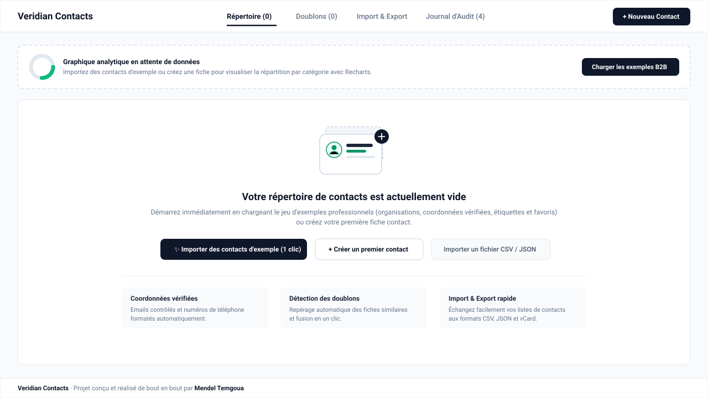
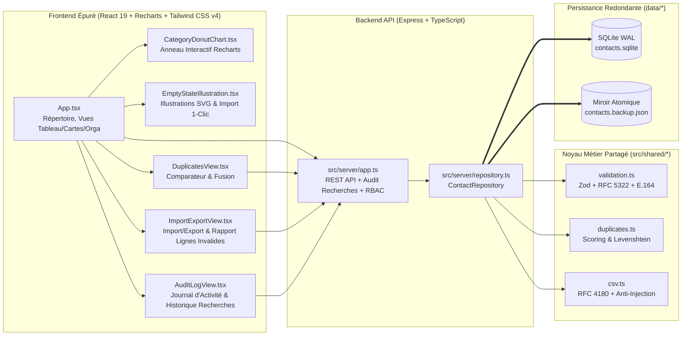

# Veridian Contacts — Gestionnaire de Contacts Professionnel

-0F172A?style=flat-square)


-10B981?style=flat-square)


> **Auteur & Réalisation** : Ce projet a été entièrement conçu, architecturé, développé, sécurisé et testé **de bout en bout par Mendel Temgoua** (`mendeltemgouabusiness@gmail.com`) — de l'analyse produit et du modèle de données jusqu'à l'API REST Express, au moteur algorithmique de déduplication et à l'interface utilisateur React 19 / Recharts épurée.

**Veridian Contacts** est une application web full-stack de gestion de contacts professionnels dotée d'une interface utilisateur épurée (sans exposition des détails techniques serveur sur le frontend), d'un graphique en anneau interactif (**Recharts**) dans l'en-tête du répertoire, d'états vides vectoriels avec chargement d'exemples en 1 clic, d'une recherche exacte et partielle journalisée pour la conformité, d'un assistant de détection et de fusion des doublons, et d'un module d'import/export CSV, JSON et vCard (`.vcf`) avec signalement des erreurs ligne par ligne.

---

## Sommaire

1. [Galerie Visuelle Complète de Bout en Bout](#1-galerie-visuelle-complète-de-bout-en-bout)
2. [Fonctionnalités & Critères d'Acceptation](#2-fonctionnalités--critères-dacceptation)
3. [Architecture & Structure du Projet](#3-architecture--structure-du-projet)
4. [Installation & Démarrage Rapide](#4-installation--démarrage-rapide)
5. [Tests Automatisés, Qualité & CI](#5-tests-automatisés-qualité--ci)
6. [Documentation Technique & Guides](#6-documentation-technique--guides)
7. [Auteur & Réalisation de Bout en Bout](#7-auteur--réalisation-de-bout-en-bout)

---

## 1. Galerie Visuelle Complète de Bout en Bout

### A. Répertoire Épuré, Graphique en Anneau Recharts & Panneau Détail Contact

*En-tête analytique avec graphique en anneau interactif Recharts (inspection au survol et filtrage direct au clic), recherche partielle/exacte, vues Tableau / Cartes / Organisations et panneau détail épuré.*

### B. États Vides Vectoriels & Importation d'Exemples en 1 Clic

*Illustrations vectorielles SVG légères lorsque la base est vide ou qu'un filtre ne retourne aucun résultat, avec bouton d'action rapide pour charger immédiatement un jeu d'exemples B2B.*

### C. Centre de Déduplication & Assistant de Fusion Côte à Côte

*Détection multicritère (email identique, téléphone normalisé, homonymes, inversion Prénom/Nom et distance de Levenshtein) avec comparateur côte à côte et aperçu en direct de la fiche fusionnée.*

### D. Importation CSV / JSON & Rapport d'Anomalies Ligne par Ligne

*Mode simulation ou import direct isolant chaque ligne invalide avec son numéro de ligne exact et le détail des erreurs par champ sans bloquer les entrées valides.*

### E. Journal d'Activité, Historique de Conformité des Recherches & Profils d'Accès

*Traçabilité complète des opérations et historique dédié des requêtes de recherche (`SEARCH_CONTACTS`) avec relance en 1 clic et filtrage par profil (`Administrateur`, `Éditeur`, `Lecteur`).*

---

## 2. Fonctionnalités & Critères d'Acceptation

| Domaine Fonctionnel | Détails de l'Implémentation | Statut |
| :--- | :--- | :---: |
| **Interface Épurée & Recharts** | Graphique en anneau interactif **Recharts** dans l'en-tête (survol + filtrage au clic), états vides vectoriels SVG avec chargement d'exemples en 1 clic, et zéro jargon technique backend sur le frontend. | Validé |
| **CRUD & Multi-Vues** | Création, édition, suppression avec modale de confirmation, favoris, étiquettes rapides, **Vue Tableau**, **Vue Cartes de visite**, **Vue Organisations**, **Index A–Z** et actions groupées. | Validé |
| **Validation Email & Téléphone** | Validation email stricte (**RFC 5322**) et normalisation téléphonique internationale (**E.164** : `06 14 28 39 50` $\rightarrow$ `+33614283950`). | Validé |
| **Recherche Exacte / Partielle & Audit** | Basculement entre **Partielle (Contient)** et **Exacte (Stricte)** avec journalisation automatique des recherches dans le **Journal d'Audit** pour la conformité et le suivi d'usage. | Validé |
| **Import Invalide Signalé** | Parseur CSV (RFC 4180, auto-détection `,` / `;`, alias d'en-têtes FR/EN) et JSON signalant le **numéro de ligne exact** et les erreurs par champ pour chaque ligne rejetée. | Validé |
| **Export CSV / JSON / vCard** | Export CSV (UTF-8 avec BOM Excel et protection contre l'injection de formules `=`, `+`, `-`, `@`), export JSON structuré et export individuel **vCard (`.vcf`)**. | Validé |
| **Détection & Fusion Doublons** | Détection automatique des doublons et fusion transactionnelle combinant étiquettes et notes. | Validé |
| **Sauvegarde Fiable** | Base **SQLite en mode journalisé WAL** doublée d'un **miroir JSON atomique** (`data/contacts.backup.json`) synchronisé à chaque écriture. | Validé |

---

## 3. Architecture & Structure du Projet



### Arborescence Complète du Dépôt

```text
veridian-contacts/
├── docs/
│   ├── screenshots/                           # 5 Captures d'écran vectorielles HD de bout en bout
│   │   ├── 01-directory-workspace.svg         # Répertoire épuré + Anneau Recharts + Fiche détail
│   │   ├── 02-duplicate-merge-wizard.svg      # Comparateur et assistant de fusion de doublons
│   │   ├── 03-import-validation-report.svg    # Import CSV/JSON et rapport d'erreurs ligne par ligne
│   │   ├── 04-audit-rbac-security.svg         # Journal d'activité et historique des recherches
│   │   └── 05-empty-state-quick-import.svg    # États vides vectoriels et import d'exemples en 1 clic
│   ├── USER_GUIDE.md                          # Guide utilisateur visuel complet pas à pas
│   ├── API_REFERENCE.md                       # Spécification complète de l'API REST & exemples curl
│   └── DEPLOYMENT.md                          # Guide de déploiement Node, Docker & sauvegarde
├── src/
│   ├── shared/                                # Logique métier pure partagée Client/Serveur
│   │   ├── types.ts                           # Interfaces TypeScript, Enums & contrats API
│   │   ├── validation.ts                      # Validation Zod, Email RFC 5322 & Téléphone E.164
│   │   ├── duplicates.ts                      # Algorithme de détection et fusion de doublons
│   │   └── csv.ts                             # Parseur et sérialiseur CSV RFC 4180 sécurisé
│   ├── server/                                # Couche Backend Express & Accès aux données
│   │   ├── app.ts                             # Routes REST, journalisation des recherches et RBAC
│   │   ├── repository.ts                      # Requêtes préparées SQLite WAL & Miroir JSON
│   │   └── seedData.ts                        # Jeu de données synthétique initial (10 contacts)
│   ├── services/
│   │   └── apiClient.ts                       # Client HTTP typé & générateur vCard (.vcf)
│   ├── components/                            # Composants d'interface React 19
│   │   ├── CategoryDonutChart.tsx             # Graphique en anneau interactif Recharts au survol/clic
│   │   ├── EmptyStateIllustration.tsx         # Illustrations vectorielles SVG & import rapide
│   │   ├── ContactFormModal.tsx               # Modale Création/Édition avec validation live
│   │   ├── DuplicatesView.tsx                 # Centre de déduplication et fusion côte à côte
│   │   ├── ImportExportView.tsx               # Module Import/Export CSV/JSON & Sauvegarde
│   │   └── AuditLogView.tsx                   # Journal d'activité & Historique des recherches
│   ├── App.tsx                                # Espace de travail principal épuré
│   ├── main.tsx                               # Point d'entrée React
│   └── index.css                              # Configuration Tailwind CSS v4 & typographie
├── tests/
│   └── contacts.test.ts                       # Suite de 14 tests unitaires, intégration & conformité
├── ci/
│   └── github-actions-ci.yml                  # Pipeline CI GitHub Actions (Lint + Tests + Build)
├── server.ts                                  # Serveur Full-Stack Express + Vite (Port 3000)
├── Dockerfile                                 # Build multi-stage Node 22 non-root
├── docker-compose.yml                         # Orchestration Docker avec volume persistant
├── architecture.md                            # Dossier d'architecture logicielle & sécurité
├── SECURITY.md                                # Politique de sécurité et contrôles implémentés
├── CONTRIBUTING.md                            # Conventions de développement et de contribution
├── .env.example                               # Modèle des variables d'environnement
└── LICENSE                                    # Licence Apache 2.0
```

---

## 4. Installation & Démarrage Rapide

### Prérequis
- **Node.js** `>= 20.x` et **npm** `>= 10.x`

### Lancement en local
```bash
# 1. Copier la configuration d'exemple
cp .env.example .env

# 2. Installer les dépendances
npm install

# 3. Démarrer le serveur full-stack sur http://localhost:3000
npm run dev
```

---

## 5. Tests Automatisés, Qualité & CI

La suite de **14 tests automatisés** (**Vitest** + **Supertest**) valide l'ensemble des règles métier, les 3 critères d'acceptation critiques et la journalisation de conformité des recherches sur des instances SQLite isolées :

```bash
# Vérification stricte du typage TypeScript
npm run lint

# Exécution des 14 tests unitaires, d'intégration et de conformité
npm test

# Build de production du frontend
npm run build
```

---

## 6. Documentation Technique & Guides

- [**Guide Utilisateur Illustré de Bout en Bout (`docs/USER_GUIDE.md`)**](./docs/USER_GUIDE.md)
- [**Référence Technique de l'API REST (`docs/API_REFERENCE.md`)**](./docs/API_REFERENCE.md)
- [**Guide de Déploiement & Docker (`docs/DEPLOYMENT.md`)**](./docs/DEPLOYMENT.md)
- [**Architecture Logicielle & Diagrammes Mermaid (`architecture.md`)**](./architecture.md)
- [**Politique de Sécurité (`SECURITY.md`)**](./SECURITY.md)
- [**Guide de Contribution (`CONTRIBUTING.md`)**](./CONTRIBUTING.md)

---

## 7. Auteur & Réalisation de Bout en Bout

Ce projet a été **intégralement conçu, architecturé, développé, testé et documenté de bout en bout par Mendel Temgoua** :

- **Conception Produit & Architecture Logicielle** : Définition du modèle métier, séparation stricte `shared` / `server` / `client`, et double persistance transactionnelle SQLite WAL + miroir JSON atomique.
- **Ingénierie Backend & Sécurité** : API REST Express typée, validation stricte RFC 5322 & normalisation internationale E.164, moteur algorithmique de déduplication (scoring + distance de Levenshtein), contrôle d'accès RBAC (`admin`, `editor`, `viewer`), protection anti-injection CSV et journal d'audit immuable incluant la traçabilité des recherches (`SEARCH_CONTACTS`).
- **Interface Utilisateur Épurée, UX & Data Visualization** : Espace de travail React 19 + Tailwind CSS v4 sans exposition de détails techniques serveur, graphique analytique en anneau interactif avec **Recharts**, illustrations vectorielles SVG pour les états vides avec import d'exemples en 1 clic, et comparateur de fusion côte à côte.
- **Qualité & Industrialisation** : Suite de tests automatisés Vitest & Supertest (14/14 tests passants), conteneurisation Docker multi-stage et pipeline CI.

**Contact Auteur** : **Mendel Temgoua** — [`mendeltemgouabusiness@gmail.com`](mailto:mendeltemgouabusiness@gmail.com)
