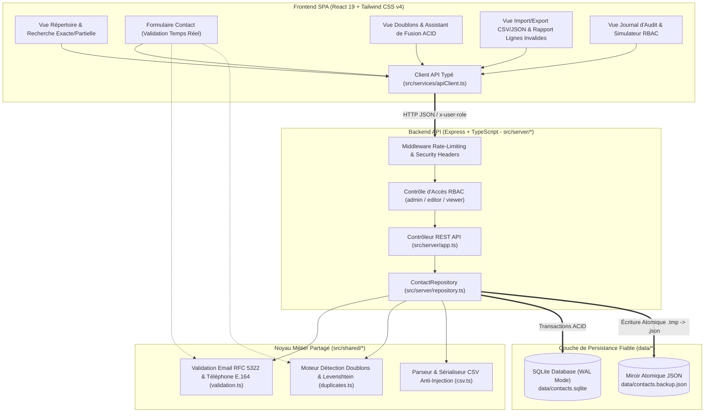
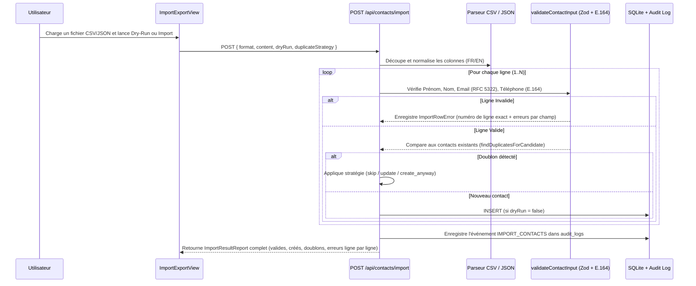

# Architecture Logicielle — Veridian Contacts

## 1. Vue d'ensemble et Justification de la Stack Technique

Bien que la stack indicative mentionnait `Python, SQLite ou JSON, pytest`, ce produit est réalisé avec une architecture **Full-Stack TypeScript unifiée (Node.js + Express + SQLite `better-sqlite3` en mode WAL + Miroir atomique JSON + React 19 + Tailwind CSS v4 + Zod + Vitest & Supertest)** pour les raisons architecturales suivantes :

1. **Typage strict de bout en bout (Shared Domain Contracts)** : Les modèles de données (`src/shared/types.ts`), les règles de validation RFC 5322 / E.164 (`src/shared/validation.ts`), l'algorithme de détection de doublons (`src/shared/duplicates.ts`) et le parseur/sérialiseur CSV RFC 4180 (`src/shared/csv.ts`) sont partagés sans duplication entre le serveur Express et l'interface React.
2. **Double persistance hybride SQLite WAL + Miroir JSON (`sauvegarde fiable`)** :
   - **Moteur primaire** : SQLite (`better-sqlite3`) configuré avec `PRAGMA journal_mode = WAL`, `PRAGMA synchronous = NORMAL` et transactions ACID.
   - **Moteur secondaire (Miroir atomique JSON)** : À chaque mutation transactionnelle, un fichier JSON complet est écrit de manière atomique (`.tmp` puis `renameSync`) dans `data/contacts.backup.json`. Si la base SQLite est initialisée à vide en présence d'un miroir JSON, elle restaure automatiquement les données.
3. **Suite de tests automatisés rapide et isolée (`Vitest` + `Supertest`)** : Équivalent moderne de `pytest` dans l'écosystème TypeScript, permettant de tester à la fois les fonctions pures (validation, doublons, CSV) et l'API HTTP complète sur des bases SQLite temporaires isolées.

---

## 2. Diagramme d'Architecture des Composants (Mermaid)

---

## 3. Flux d'Importation et Signalement des Lignes Invalides

---

## 4. Modèle de Données (Schéma SQLite)

### Table `contacts`
| Colonne | Type SQLite | Contraintes | Description |
| :--- | :--- | :--- | :--- |
| `id` | `TEXT` | `PRIMARY KEY` | Identifiant UUID v4 |
| `first_name` | `TEXT` | `NOT NULL` | Prénom (1 à 80 caractères) |
| `last_name` | `TEXT` | `NOT NULL` | Nom de famille (1 à 80 caractères) |
| `email` | `TEXT` | `NOT NULL`, Indexé | Adresse email normalisée en minuscules |
| `phone` | `TEXT` | `NOT NULL` | Numéro de téléphone au format d'affichage |
| `phone_normalized` | `TEXT` | `NOT NULL`, Indexé | Numéro normalisé au format canonique E.164 (`+33...`) |
| `company` | `TEXT` | `NOT NULL DEFAULT ''` | Entreprise / Organisation |
| `job_title` | `TEXT` | `NOT NULL DEFAULT ''` | Intitulé de poste |
| `category` | `TEXT` | `NOT NULL`, Indexé | `client`, `partenaire`, `fournisseur`, `prospect`, `interne`, `autre` |
| `tags_json` | `TEXT` | `NOT NULL DEFAULT '[]'` | Liste d'étiquettes sérialisée en JSON |
| `notes` | `TEXT` | `NOT NULL DEFAULT ''` | Notes métier (max 2000 caractères) |
| `city` | `TEXT` | `NOT NULL DEFAULT ''` | Ville |
| `country` | `TEXT` | `NOT NULL DEFAULT 'France'` | Pays |
| `favorite` | `INTEGER` | `NOT NULL DEFAULT 0` | Booléen (`0` ou `1`) |
| `created_at` | `TEXT` | `NOT NULL` | Horodatage ISO 8601 UTC |
| `updated_at` | `TEXT` | `NOT NULL` | Horodatage ISO 8601 UTC |

### Table `audit_logs`
| Colonne | Type SQLite | Contraintes | Description |
| :--- | :--- | :--- | :--- |
| `id` | `TEXT` | `PRIMARY KEY` | Identifiant UUID v4 |
| `timestamp` | `TEXT` | `NOT NULL`, Indexé DESC | Horodatage ISO 8601 UTC |
| `actor_role` | `TEXT` | `NOT NULL` | Rôle ayant déclenché l'action (`admin`, `editor`, `viewer`) |
| `action` | `TEXT` | `NOT NULL` | Type d'événement (`CREATE_CONTACT`, `IMPORT_CONTACTS`, `PERMISSION_DENIED`, etc.) |
| `target_id` | `TEXT` | `NULL` | Identifiant du contact concerné |
| `summary` | `TEXT` | `NOT NULL` | Description lisible de l'opération |
| `metadata_json` | `TEXT` | `NOT NULL DEFAULT '{}'` | Contexte technique sérialisé en JSON |

---

## 5. Modèle de Permissions (RBAC)

Le serveur vérifie l'en-tête `x-user-role` sur chaque route sensible et journalise tout refus (`403 Forbidden`) dans `audit_logs` avec l'action `PERMISSION_DENIED`.

| Opération / Route API | `viewer` (Lecteur) | `editor` (Éditeur) | `admin` (Administrateur) |
| :--- | :---: | :---: | :---: |
| Consultation & Recherche (`GET /api/contacts`) | Autorisé | Autorisé | Autorisé |
| Export CSV / JSON (`GET /api/contacts/export`) | Autorisé | Autorisé | Autorisé |
| Création & Modification (`POST`, `PUT /api/contacts`) | Refusé (`403`) | Autorisé | Autorisé |
| Import CSV / JSON (`POST /api/contacts/import`) | Refusé (`403`) | Autorisé | Autorisé |
| Fusion de doublons (`POST /api/contacts/merge`) | Refusé (`403`) | Autorisé | Autorisé |
| Suppression de contact (`DELETE /api/contacts/:id`) | Refusé (`403`) | Refusé (`403`) | Autorisé |
| Réinitialisation démo (`POST /api/contacts/seed-reset`) | Refusé (`403`) | Refusé (`403`) | Autorisé |

---

## 6. Analyse des Risques, Sécurité et Confidentialité

1. **Injections SQL** : Toutes les requêtes SQLite utilisent exclusivement des requêtes préparées paramétrées (`db.prepare(...).run(...)`).
2. **Injection de formules CSV (CSV / DDE Injection)** : Lors de l'export CSV, toute cellule débutant par `=`, `+`, `-`, `@`, `\t` ou `\r` est automatiquement préfixée par une apostrophe `'` (`sanitizeCsvCell`) afin d'empêcher l'exécution de macros malveillantes à l'ouverture dans Excel ou LibreOffice Calc.
3. **Déni de service (DoS) sur l'import et l'API** :
   - Limite de taille du corps JSON fixée à `2mb` (`express.json({ limit: '2mb' })`).
   - Limite de lot d'import fixée à `2000` lignes maximum par requête.
   - Rate-limiting en mémoire par IP sur toutes les routes `/api/*` (`180` requêtes/minute par défaut).
4. **Confidentialité (RGPD / Données personnelles)** :
   - Le dépôt n'embarque aucune donnée réelle : les 10 contacts initiaux sont 100 % synthétiques.
   - Les fichiers de base de données locale (`data/*.sqlite`, `data/*.json`) ne contiennent aucun secret.
