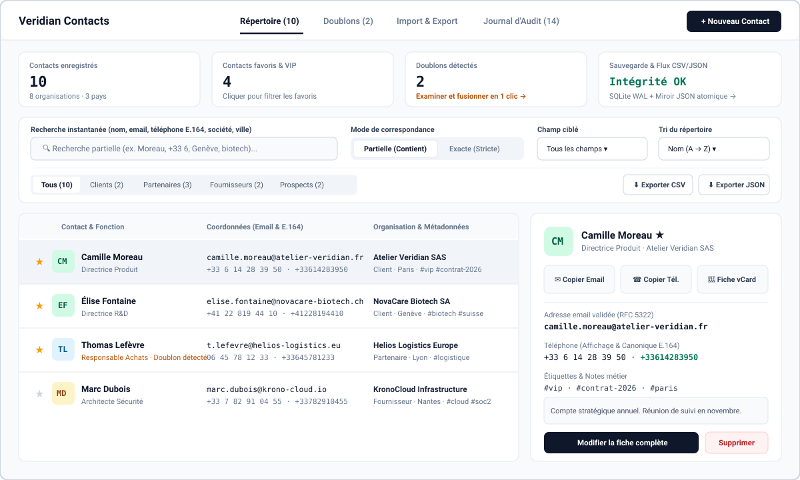
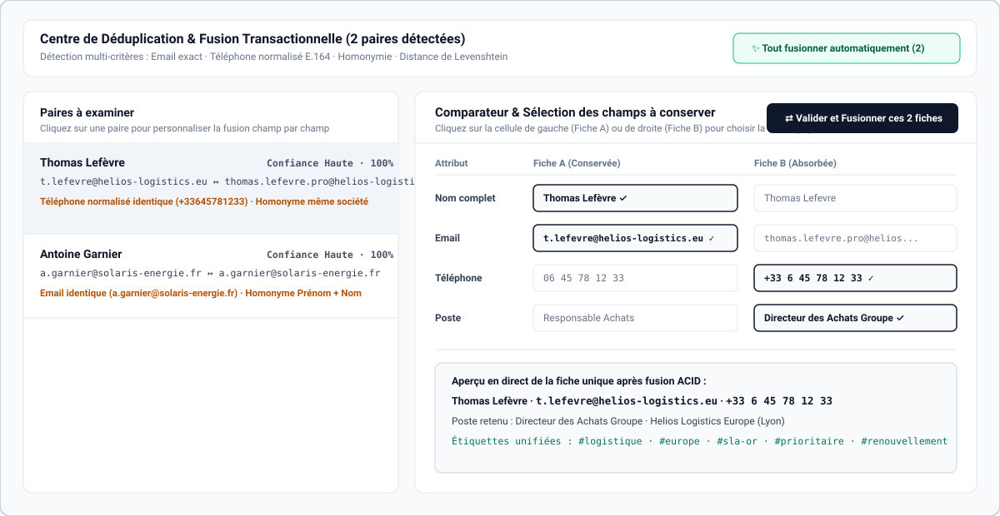
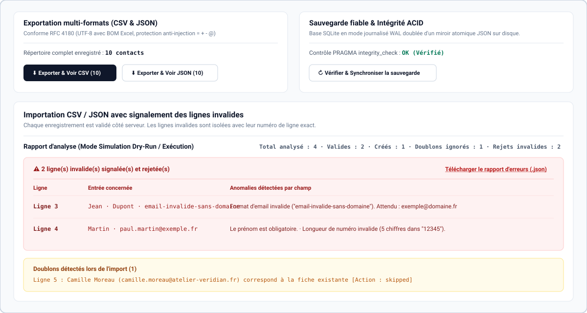
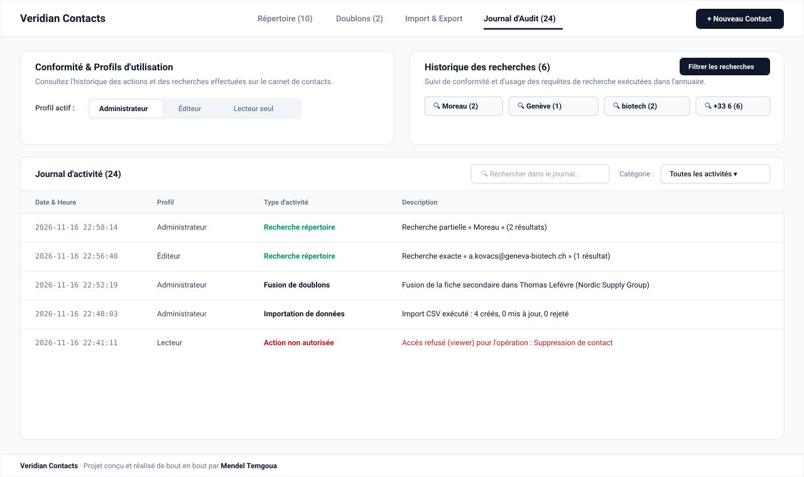

# Guide Utilisateur Visuel — Veridian Contacts

Ce guide présente pas à pas les fonctionnalités de **Veridian Contacts** avec des captures d'écran de l'interface.

---

## 1. Espace de Travail Principal, Recherche Exacte/Partielle & Fiche Détail

### A. Bandeau de Pilotage (Indicateurs Clés)
En haut de l'espace de travail, quatre cartes interactives vous permettent de piloter votre carnet en un clic :
1. **Contacts enregistrés** : Affiche le volume total, le nombre d'organisations et de pays. Cliquez dessus pour réinitialiser tous les filtres.
2. **Contacts favoris & VIP** : Cliquez pour afficher uniquement vos contacts stratégiques marqués d'une étoile `★`.
3. **Doublons détectés** : Affiche en temps réel le nombre de paires de doublons identifiées et ouvre l'assistant de fusion.
4. **Sauvegarde & Flux CSV/JSON** : Indique le statut d'intégrité (`PRAGMA integrity_check: OK`) de la base SQLite WAL et du miroir JSON atomique.

### B. Recherche Exacte vs Recherche Partielle
- **Mode Partielle (Contient)** : Recherche multi-mots insensible à la casse et aux accents sur l'ensemble des champs (ou un champ ciblé). Par exemple, saisir `Moreau Paris` ou `biotech` filtre instantanément les fiches correspondantes.
- **Mode Exacte (Stricte)** : Exige une correspondance exacte sur le champ ciblé.
  - *Astuce Téléphone E.164* : Même si la fiche est enregistrée sous `+33 6 14 28 39 50`, une recherche exacte sur `0614283950` aboutit grâce à la normalisation canonique `+33614283950`.

### C. Modes d'affichage (Tableau / Cartes) & Index Alphabétique A–Z
- Basculez entre la **Vue Tableau** (idéale pour le tri, la sélection multiple et le traitement par lot) et la **Vue Cartes** (cartes de visite avec avatars d'initiales).
- Utilisez la barre **A–Z Tous** pour filtrer par la première lettre du nom de famille.

### D. Panneau Latéral d'Inspection & Export vCard (`.vcf`)
En cliquant sur n'importe quel contact :
- Copiez l'adresse email ou le numéro E.164 en un clic avec confirmation visuelle (`Copié !`).
- Téléchargez la **Fiche vCard (`.vcf`)** compatible Apple Contacts, Google Contacts et Microsoft Outlook.
- Ajoutez ou retirez des étiquettes (`#vip`, `#prioritaire`) directement à la volée.

---

## 2. Détection des Doublons & Assistant de Fusion ACID

Le moteur de déduplication analyse quatre niveaux de correspondance :
1. **Email exact** (score 100 %)
2. **Téléphone normalisé E.164 identique** (ex. `06 45 78 12 33` et `+33 6 45 78 12 33` $\rightarrow$ `+33645781233`, score 95 %)
3. **Homonymie Prénom + Nom (+ Entreprise)** (score 82 % à 90 %)
4. **Inversion Prénom/Nom ou proximité orthographique (Distance de Levenshtein = 1)** (score 75 % à 78 %)

### Comment fusionner deux fiches en doublon :
1. Sélectionnez la paire à gauche dans la liste **Paires à examiner**.
2. Dans le tableau comparatif de droite, cliquez sur chaque valeur que vous souhaitez conserver entre la **Fiche A** et la **Fiche B**.
3. Vérifiez l'encadré **Aperçu du résultat après fusion** en bas : les étiquettes et les notes des deux fiches sont automatiquement combinées sans perte d'information.
4. Cliquez sur **Valider et Fusionner ces 2 fiches** (ou sur **Tout fusionner automatiquement** pour traiter tout le lot en un clic).

---

## 3. Import / Export CSV & JSON et Signalement des Lignes Invalides

### A. Vérification et Signalement des Lignes Invalides
1. Ouvrez l'onglet **Import & Export**.
2. Chargez votre fichier `.csv` ou `.json` (ou cliquez sur le bouton **« Jeu d'essai CSV avec erreurs (Démo QA) »** pour tester immédiatement le contrôle qualité).
3. Choisissez la politique de gestion des doublons :
   - *Ignorer les doublons et les signaler dans le rapport* (`skip`)
   - *Mettre à jour la fiche existante correspondante* (`update`)
   - *Importer malgré tout comme nouvelle fiche* (`create_anyway`)
4. Cliquez sur **Simuler & Vérifier les erreurs (Dry-Run)** pour tester sans modifier la base, ou sur **Exécuter l'importation des lignes valides**.
5. Le rapport affiche :
   - Le nombre exact de lignes analysées, créées, mises à jour, ignorées ou rejetées.
   - Le tableau détaillé des **lignes invalides avec leur numéro de ligne exact** (ex. `Ligne 3`, `Ligne 4`) et le message d'erreur précis par champ (`email`, `phone`, `firstName`).
   - Un bouton pour télécharger le rapport d'anomalies au format `.json`.

---

## 4. Contrôle d'Accès (RBAC) & Journal d'Audit

- **Sélecteur de Rôle RBAC** : Situé dans la barre d'outils supérieure et dans l'onglet **Journal d'Audit**, il permet de basculer entre :
  - `admin` : Tous les droits (CRUD, import/export, fusion, suppression, réinitialisation).
  - `editor` : Création, modification, import/export et fusion, **sans droit de suppression**.
  - `viewer` : Consultation, recherche et export uniquement.
- Toute tentative d'action non autorisée renvoie une erreur `403 Forbidden` et génère immédiatement une entrée `PERMISSION_DENIED` dans le **Journal d'Audit**.
